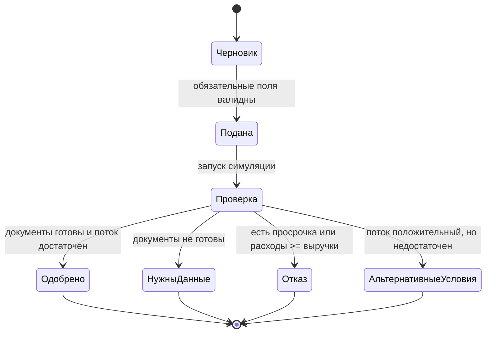

# Диаграмма состояний заявки

Фактическая реализация хранит исходный статус `Подана`, а затем результат проверки и итоговый статус. Для повторной проверки пользователь может изменить профиль и создать новую заявку.
