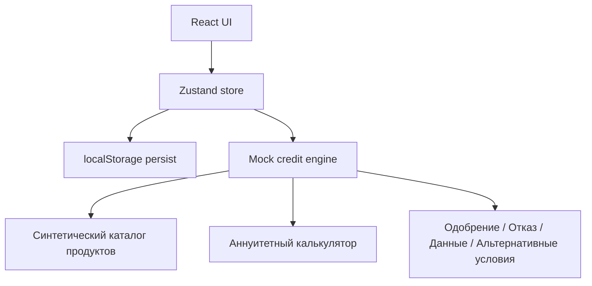

# Архитектура MVP

## Поток

1. Клиент описывает потребность в чате. Правила извлекают простые признаки из текста и добавляют сообщение в историю.
2. Клиент подтверждает финансовый профиль.
3. Каталог синтетических продуктов сравнивается по ставке, сроку и расчётному платежу.
4. При отправке заявки создаётся ID и фиксируется копия профиля на момент отправки.
5. Действие «Запустить проверки» вызывает детерминированные правила мок-кредитного движка.
6. Результат сохраняется в заявке и отображается в UI.

## Границы

Нет backend, авторизации, реального скоринга, внешних проверок, банковского решения, электронной подписи и перечисления денег. Данные — синтетические. `localStorage` выбран только для ускорения MVP; в промышленной системе требуется серверное хранение, аудит и контроль доступа.
